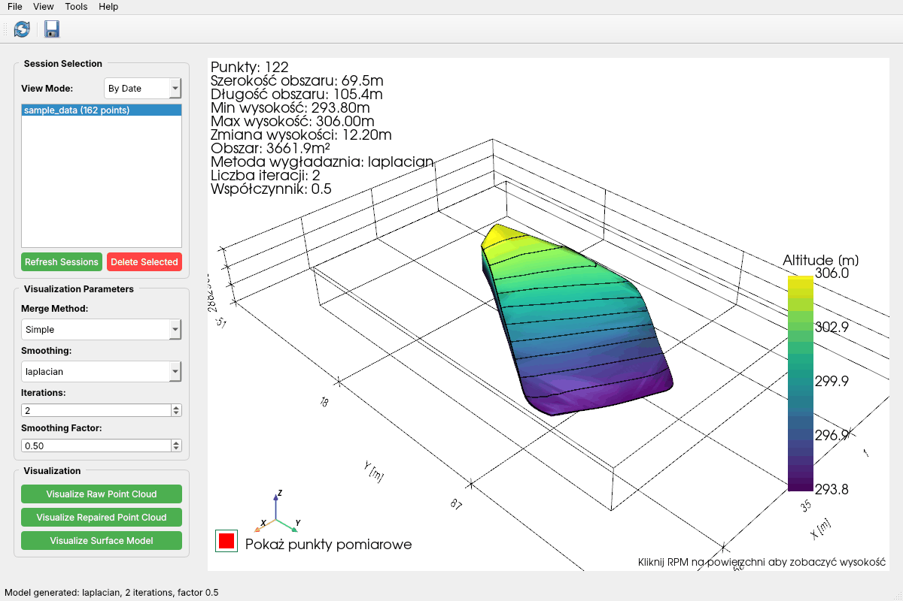
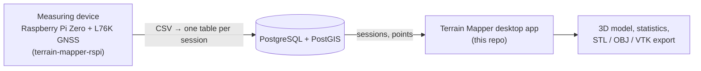
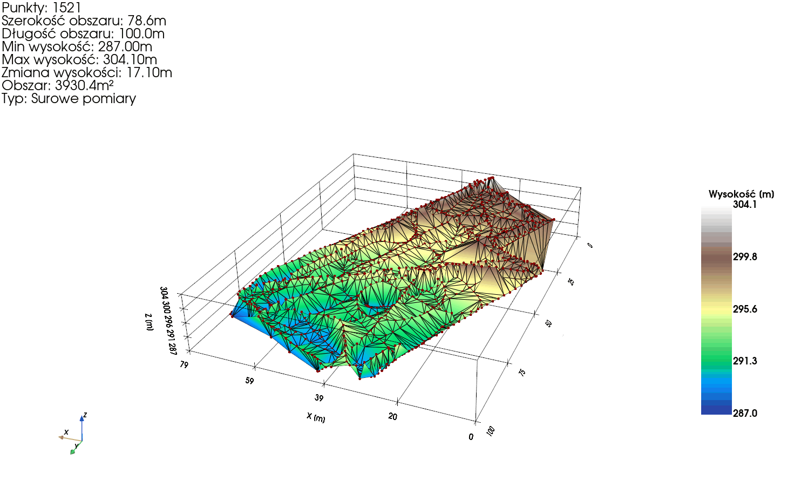
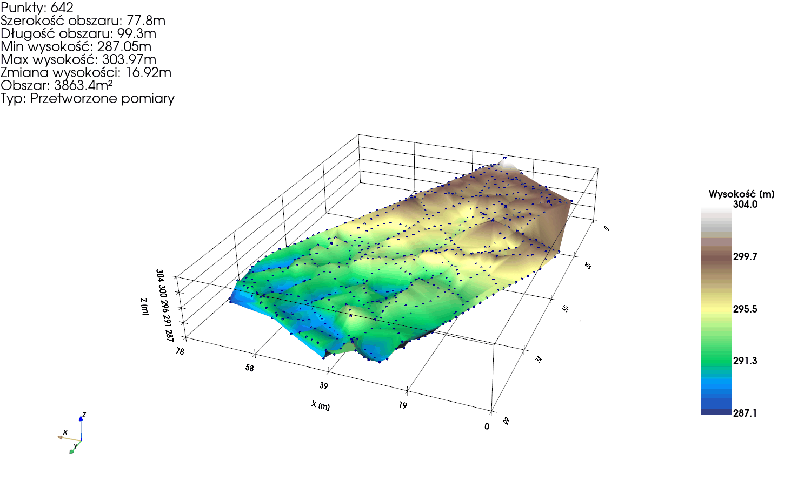
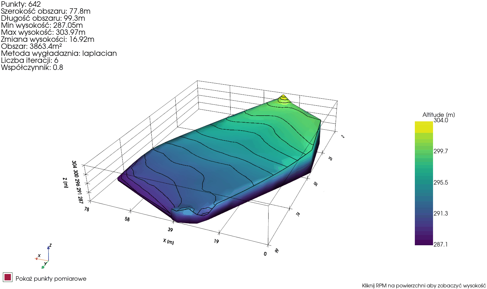
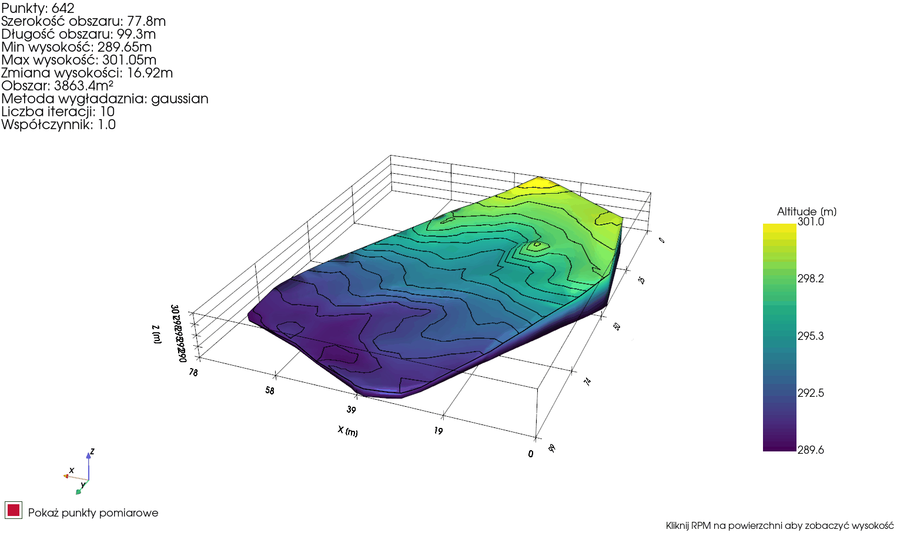
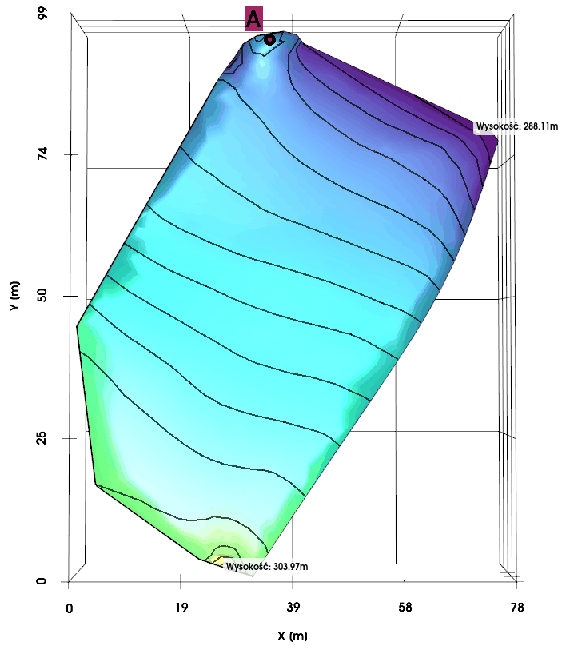

# terrain-mapper-desktop

Desktop application that turns low-cost GNSS measurements into interactive 3D terrain models. It reads measurement sessions from a PostgreSQL/PostGIS database, cleans the point cloud, builds a smoothed surface model and exports it to STL/OBJ/VTK.

This is the visualisation part of a two-component system built as my BSc Eng. thesis at AGH University of Krakow (2024). The measuring device lives in **[terrain-mapper-rspi](https://github.com/Krypel20/terrain-mapper-rspi)**.

**Stack:** Python · PyQt6 · PyVista (VTK) · NumPy / pandas / SciPy / scikit-learn · pyproj · PostgreSQL 16 + PostGIS



---

## How it fits together



The device records `time, latitude, longitude, altitude` while the user walks over the terrain and uploads each session to its own table (`session_DDMMYY_HHMMSS`). The desktop app only reads those tables; it does not depend on the device being online.

## Features

- **Session browser** – lists sessions by date or groups them by location (PostGIS `ST_DWithin`, 1 km radius around each session centroid) with reverse-geocoded place names (GeoPy / Nominatim). Sessions load in a background `QThread`, so the UI stays responsive.
- **Multi-session merge** – several passes over the same area can be combined (simple concatenation or averaging of points closer than 1 m).
- **Point cloud cleaning** – points within 1.5 m in the XY plane are clustered (scikit-learn `BallTree`); in each cluster altitudes outside `[Q1 − 1.5·IQR, Q3 + 1.5·IQR]` are rejected and the cluster is replaced by one point with the mean of the remaining heights (median as fallback).
- **Surface model** – WGS84 → metric projection (pyproj), Delaunay triangulation (TIN), then Laplacian or custom Gaussian-kernel smoothing with user-set iterations and strength.
- **Visual analysis** – hypsometric colouring, 1 m contour lines, extruded terrain block, toggleable measurement points, click-to-read altitude markers and on-screen statistics (point count, extent, min/max altitude, relief).
- **Export** – the generated model can be saved as STL, OBJ or VTK. An example export is in [`examples/terrain_model_laplacian.stl`](examples/terrain_model_laplacian.stl) (GitHub renders it in an interactive 3D viewer).

## Processing pipeline

Field test from the thesis: five walking sessions over a ~78 × 99 m plot, 1521 raw GNSS points.

| 1. Raw point cloud (1521 pts) | 2. After cluster/outlier filtering (642 pts) |
|---|---|
|  |  |
| **3. Laplacian smoothing (6 iterations, factor 0.8)** | **4. Gaussian-kernel smoothing (10 iterations, factor 1.0)** |
|  |  |

Validation against official elevation data (Geoportal / GUGiK) showed the expected behaviour of a single-frequency receiver: the terrain shape and contour layout match the reference model, while absolute heights carry a systematic offset of roughly 5–6 m. In favourable conditions (HDOP < 1.5) the vertical accuracy of the system was about ±2.5 m. For this plot Laplacian smoothing gave the more faithful surface; the Gaussian variant kept local bumps from imprecise points that survived filtering.

<p align="center"></p>

## Database

```text
measurement_sessions
  id, session_name, start_time, end_time, location_name,
  area_centroid GEOGRAPHY(POINT, 4326)      -- GiST index, used for grouping

session_<DDMMYY_HHMMSS>                     -- one table per session
  id, measurement_time, location GEOGRAPHY(POINT, 4326), altitude NUMERIC(10,2)
  [vdop, baro_alt]                          -- later device versions (vdop holds HDOP)
```

The full schema is in [`sql/schema.sql`](sql/schema.sql). Sessions uploaded by device versions that did not store `area_centroid` can be fixed with [`sql/backfill_centroids.sql`](sql/backfill_centroids.sql); without a centroid they are visible only in the *By Date* view.

## Getting started

Requirements: Python 3.10+, PostgreSQL with the PostGIS extension. The app was developed on Windows 10/11; the commands below use PowerShell.

```powershell
git clone https://github.com/Krypel20/terrain-mapper-desktop.git
cd terrain-mapper-desktop
python -m venv .venv
.venv\Scripts\activate
pip install -r requirements.txt
```

Create the database and set the connection (defaults are listed in [`.env.example`](.env.example)):

```powershell
createdb -U postgres terrain_measurements
psql -U postgres -d terrain_measurements -f sql/schema.sql

$env:TM_DB_USER = "postgres"
$env:TM_DB_PASSWORD = "admin"
$env:TM_DB_PORT = "5432"
```

Load the bundled sample session (162 points recorded on 19 Oct 2024) and start the app:

```powershell
python scripts/import_csv.py data/sample_data.csv --session sample_data --date 2024-10-19
python desktop/main.py
```

Select a session on the left and use **Visualize Raw Point Cloud**, **Visualize Repaired Point Cloud** or **Visualize Surface Model**. Right-click on the surface to read the altitude at a point; **File → Export Model** (Ctrl+E) saves the current model.

## Project structure

```text
├── desktop/
│   ├── main.py            # PyQt6 window, point processing, surface generation, export
│   └── db_connection.py   # PostgreSQL/PostGIS access (sessions, grouping, deletion)
├── scripts/
│   └── import_csv.py      # load a measurement CSV without the device
├── sql/                   # database schema, centroid backfill
├── data/sample_data.csv   # sample measurement session
├── examples/              # exported STL model
└── docs/img/              # screenshots used in this README
```

## Limitations and next steps

This is a working thesis prototype rather than a finished product:

- the application logic sits mostly in a single `main.py` module and has no automated tests;
- Kriging interpolation (PyKrige) was prototyped but is not exposed in the UI;
- the *Weighted* merge expects per-point quality data (HDOP), which the stored sessions do not include, so it currently behaves like *Average*;
- on-screen statistics are in Polish and the reported area is a bounding-box approximation;
- reverse geocoding requires internet access (Nominatim); without it groups are labelled with coordinates.

Planned directions from the thesis: a more accurate (multi-frequency / RTK-capable) GNSS receiver on the device side, cross-section profiles and slope maps in the app, and additional interpolation methods.

## Thesis

*Implementacja systemu do trójwymiarowej analizy ukształtowania terenu* (Implementation of a system for three-dimensional terrain analysis), Piotr Krypel, AGH University of Krakow, Faculty of Metals Engineering and Industrial Computer Science, 2024. Supervisor: dr inż. Przemysław Marynowski.

## License

MIT – see [LICENSE](LICENSE).
